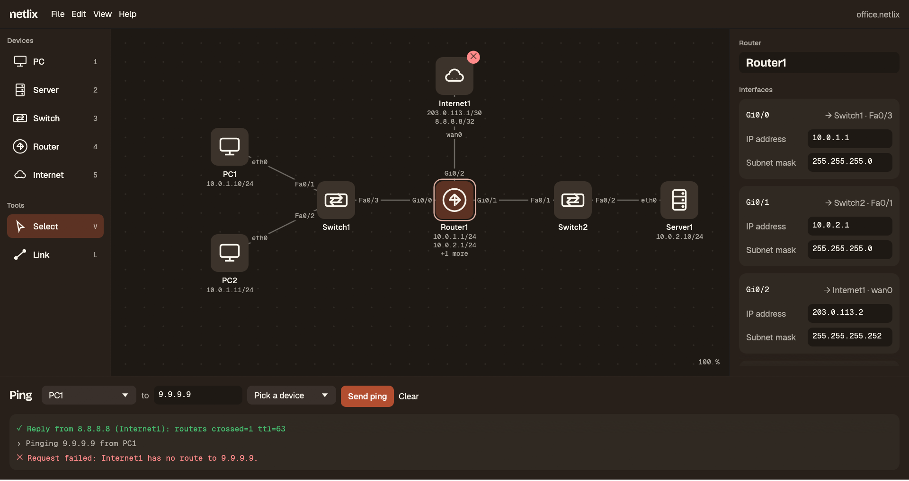

# netlix

**Draw a network, set IP addresses, and watch every frame of a ping.**

netlix is a small network simulator in the spirit of Packet Tracer, from [Helix](https://org-helix.github.io/helix-website/), which builds public-good software for the communities that mainstream tech leaves behind: schools, clinics and the people they serve. A teacher or a student can build a topology, configure it and follow ARP, switching and routing frame by frame, with no licence, no account and no connection.

Like every Helix app, netlix is free, open source and offline first. It is a single native app for Windows, Linux and macOS, written in Rust with [egui](https://github.com/emilk/egui).



## Download

One file per system, from the [latest release](https://github.com/org-helix/netlix/releases/latest):

| System | File | How to install |
|---|---|---|
| Windows 10 and 11 (x64) | [`netlix-windows-setup.exe`](https://github.com/org-helix/netlix/releases/latest/download/netlix-windows-setup.exe) | Run it. netlix installs for your account only, without administrator rights, and adds a Start menu entry. `.netlix` files then open in netlix. Uninstall it from Settings → Apps. |
| macOS 11 or later (Apple Silicon and Intel) | [`netlix-macos.dmg`](https://github.com/org-helix/netlix/releases/latest/download/netlix-macos.dmg) | Open it and drag netlix to Applications. |
| Linux (x86-64) | [`netlix-linux.AppImage`](https://github.com/org-helix/netlix/releases/latest/download/netlix-linux.AppImage) | Make it executable (`chmod +x netlix-linux.AppImage`, or Properties → Allow executing as program), then run it. |

On first launch netlix asks for its language and theme. Both can be changed later under **View**.

The downloads are not code-signed yet:
- Windows: SmartScreen may show "Windows protected your PC". Choose **More info → Run anyway**.
- macOS: the first time, macOS refuses to open the app. Go to **System Settings → Privacy & Security** and choose **Open Anyway** (or run `xattr -dr com.apple.quarantine /Applications/netlix.app`).

For a school or a whole machine, the Windows installer also runs silently or for every user: `netlix-windows-setup.exe /VERYSILENT /ALLUSERS` (the second needs administrator rights).

## Features

- **Canvas**: place PCs, servers, switches, routers and an Internet cloud. Drag devices to move them, scroll to zoom, drag the background to pan.
- **Links**: the Link tool (`L`) connects two devices on their first free ports. Port names are shown at each end of the link.
- **Configuration**: right-click a device → **Configure…** (or double-click it) to open its settings in a floating window, which leaves the whole width to the canvas. The window holds the IP address and subnet mask for each interface (`255.255.255.0`, `/24` or `24`), a default gateway on hosts, and static routes on routers. Invalid values are flagged as you type, as are network and broadcast addresses and off-subnet gateways. Each interface shows its MAC address.
- **Ping, frame by frame**: every Ethernet frame is simulated (ARP requests and replies, switch forwarding and flooding, routed ICMP echo request and reply) and animated on its cable. ARP frames are hollow rings, echo requests red, echo replies in the text colour. The console explains every failure, for example a missing gateway, no route, no ARP reply, a lost reply, an expired TTL or a broadcast storm.
- **Two send modes**:
  - *Real time* plays the whole exchange at once. With **Explain every frame** on, the log lists each frame with the reason it was sent and its simplified headers (Ethernet, ARP, IPv4, ICMP).
  - *Step by step* stops after every step. Use **Next / Back / Play / First / Last** or the arrow keys to see the frames on the wire, why each was sent, and what each device did on receiving it. Click a frame to highlight it on the canvas. The inspector shows ARP caches and MAC tables as they were at that step.
- **ARP caches and MAC tables**: hosts and routers keep an ARP cache and switches learn a MAC address table. Both survive between pings, so the second ping skips address resolution. They are shown in each device's configuration window. Clear one device by right-clicking it (**Clear ARP cache** / **Clear MAC table**), or all of them from the console or **Edit**.
- **Files**: New, Open, Save and Save as. Topologies are stored as readable, versioned JSON `.netlix` files. A file path given on the command line is opened at startup. If you try to close with unsaved changes, netlix asks first.
- **Title bar**: netlix draws its own title bar instead of the system one. It holds the menus, the document name (with a dot when unsaved) and minimise / maximise / close. Drag it to move the window, double-click to maximise, and resize from any edge. On macOS the native window buttons are kept.
- **First launch**: a welcome screen to choose the language and the theme, both applied live. The language is suggested from the system's. **Start with an example** opens the office topology.
- **Themes**: dark by default, light under **View → Dark mode**. The choice is remembered between sessions.
- **Languages**: French (default) and English, under **View → Language** (**Affichage → Langue**). Everything is translated: menus, panels, error messages and the explanation of every frame. Switching language re-runs the ping being stepped through so its explanations follow. New devices are named in the current language (Routeur1 / Router1).

## Simulation model

| Device | Behaviour |
|---|---|
| PC, Server | One NIC (`eth0`). Delivers on-link when the destination is in its subnet, otherwise sends to the default gateway. Never forwards traffic. |
| Switch | 8 ports with no IP. Learns source MACs per port, forwards known unicast, floods broadcasts and unknown destinations. There is no spanning tree, so a switching loop causes a broadcast storm; the simulation stops it and says so. |
| Router | 4 routed ports. Uses the longest-prefix match among connected networks and static routes, resolves the next hop with ARP, and decrements the TTL. |
| Internet | Same as a router with 4 `wan` ports. Give it a `/32` (e.g. `8.8.8.8`) to stand for a public host. |

A ping only succeeds when both the request and the reply get through. MAC addresses are `02:4e:` followed by the device number and the interface index, so they stay the same when a file is reopened.

## Usage

```sh
cargo run --release                           # empty canvas
cargo run --release -- examples/office.netlix # two LANs + Internet uplink
```

You can also use **File → Load example** for the same topology.

| Shortcut | Action |
|---|---|
| `1`–`5` | Place PC / Server / Switch / Router / Internet |
| `L`, `V`, `Esc` | Link tool, select tool, cancel |
| `Del` | Delete selection |
| `Ctrl+N/O/S`, `Ctrl+Shift+S` | New, open, save, save as |
| `Ctrl+0` | Reset view |
| `→` or `Space`, `←` | Next or previous step (step-by-step mode) |

Right-click a device for "Configure…", "Ping from here", "Link from here", "Clear ARP cache" (or "Clear MAC table" on a switch) and "Delete". Right-click a cable to delete it. `Esc` closes the configuration window.

## Development

```sh
cargo test     # simulation, file format and model tests
cargo clippy --all-targets
```

On Linux, building needs `libxkbcommon-dev libwayland-dev libgl1-mesa-dev` and the `libxcb-*` headers (see `.github/workflows/ci.yml`). File dialogs use the XDG portal, so GTK is not needed.

Code map: `i18n.rs` (languages: every text is written in French and English where it is used, with `tr(fr, en)` or `tf!(fr, en)`), `model.rs` (topology data), `sim.rs` (frame-level ping, ARP, switching, routing), `io.rs` (file format), `canvas.rs` (drawing and interaction), `panels.rs` (toolbox, inspector, console), `theme.rs` (Helix look), `welcome.rs` (first-launch screen), `titlebar.rs` (custom title bar, window move and resize), `app.rs` (state, menus, files).

## Releasing

1. Raise `version` in `Cargo.toml` (and the version shown on the [Helix website](https://github.com/org-helix/helix-website), in `src/content/site.ts`).
2. Write the release notes in `docs/releases/vX.Y.Z.md`.
3. Push a `vX.Y.Z` tag. `.github/workflows/release.yml` tests, builds the three downloads and publishes the release with those notes (or notes generated from the commits if the file is missing).

Each platform has a packaging script under `packaging/`, which can also be run by hand:

| Platform | Command (from the repository root) | Output |
|---|---|---|
| Windows | `cargo build --release`, then `iscc packaging\windows\netlix.iss` ([Inno Setup 6](https://jrsoftware.org/isinfo.php)) | `dist/netlix-windows-setup.exe` |
| macOS | `bash packaging/macos/build-dmg.sh` | `dist/netlix-macos.dmg` |
| Linux | `bash packaging/linux/build-appimage.sh` | `dist/netlix-linux.AppImage` |

Pull requests that change `packaging/` build the three files as workflow artifacts without publishing them. The app icon is drawn in `assets/icon/netlix.svg`; `assets/icon/make-icons.cjs` regenerates the PNG, ICO, ICNS and installer images from it.

## Design

netlix uses the Helix colour palette on top of the Dusk DS structure: Bricolage Grotesque titles, Geist text, a 4 px grid, 8/12/16 radii, and no drop shadows. The dark theme is the dark Helix variant: a deepened ink canvas (`#1E1914`), Pale Amber text, Red `#B24E30` as the only action colour and Blush for focus. The light theme puts ink on Pale Amber (`#FAF6ED`). All colours live in `src/theme.rs`, and a unit test checks WCAG AA contrast for both themes. Fonts are bundled under the SIL Open Font License (`assets/fonts/OFL-*.txt`).

## Privacy

- netlix never connects to the Internet. The "Internet" device is part of the simulation.
- No account, no ads, no analytics, no tracking.
- Topologies are saved only where you choose, as `.netlix` files. Settings (language, theme) stay on the computer.

## Credits

- **[Helix](https://github.com/org-helix)** designs, builds and maintains netlix. The app credits Helix on its welcome screen and under **Help**.
- **Fonts**: [Bricolage Grotesque](https://github.com/ateliertriay/bricolage) and [Geist](https://github.com/vercel/geist-font), bundled under the SIL Open Font License ([`assets/fonts`](assets/fonts)).
- **Libraries**: [egui and eframe](https://github.com/emilk/egui), [serde](https://serde.rs), [rfd](https://github.com/PolyMeilex/rfd) and [sys-locale](https://github.com/1Password/sys-locale), each under its own licence (MIT or Apache 2.0).

Questions, ideas and bug reports are welcome in the [issues](https://github.com/org-helix/netlix/issues). Before sending a change, read the [Helix contributing guide](https://github.com/org-helix/.github/blob/main/CONTRIBUTING.md); to report a security problem, follow the [security policy](https://github.com/org-helix/.github/blob/main/SECURITY.md).

## License

netlix is free software, released under the [GNU General Public License, version 3](LICENSE). You may use, study, share and change it; versions you distribute must stay under the same license. The bundled fonts keep their own license (SIL Open Font License).

> No tracking, no ads, no lock-in. Built for and with the communities that use it.
